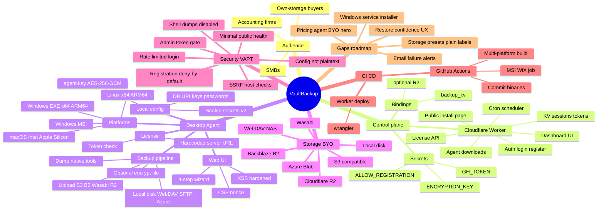

# VaultBackup — Product & Architecture Mindmap

## Structure (outline)

### 1. Audience
- SMBs and accounting firms
- Cheap backups to **their** storage (not forced managed bucket)

### 2. Control plane (Cloudflare Worker)
- Auth, KV, license, agent binary proxy, dashboard, cron
- Public: `/install`, `/download/*`
- Secrets: `ENCRYPTION_KEY`, `GH_TOKEN`; flag `ALLOW_REGISTRATION`

### 3. Desktop Agent
- **Windows** MSI + EXE (x64/ARM64), **macOS**, **Linux**
- Config secrets sealed at rest (AES-256-GCM + `agent.key`)
- Backup → encrypt optional → upload to BYO storage
- Embedded Web UI (wizard, CSP)

### 4. Storage (BYO)
- S3 / B2 / Wasabi / R2 / Azure / WebDAV / SFTP / local

### 5. Security posture
- Registration locked by default
- Minimal public health
- Admin gate, rate limits, SSRF checks
- No plaintext config secrets on disk

### 6. CI/CD
- GitHub Actions builds all platforms + MSI
- Binaries committed to private repo; Worker proxies downloads

### 7. Near-term product gaps
- Windows service installer
- Plain-language storage presets
- Failure email alerts
- Clearer restore path
- Agent + BYO as pricing hero

---

*Render the Mermaid block on GitHub or any Mermaid-compatible viewer.*
